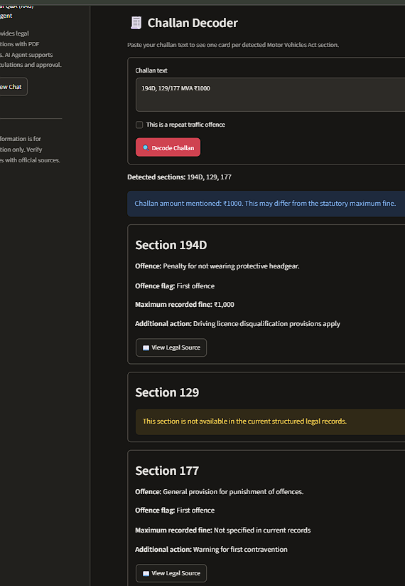

# Day 10 — Streamlit UI and Checkpoint 2

## Project: ChalanCheck

### Objective

Develop a Streamlit user interface for ChalanCheck that connects to the FastAPI backend, explains traffic challans using legal documents, displays citations, collects user feedback, and provides a section-wise Challan Decoder.

## Features Implemented

### 1. Streamlit Chat Interface

- Developed `ui/app.py` using Streamlit.
- Integrated the FastAPI `/ask` endpoint for legal questions.
- Displayed AI-generated answers and conversation history.
- Added expandable legal citations showing document sources and page numbers.

### 2. AI Agent Integration

- Integrated the `/agent` endpoint with the Streamlit interface.
- Added human approval before fine calculations.
- Implemented Approve and Reject buttons.
- Maintained agent sessions using session IDs.

### 3. Challan Decoder — Signature Feature

Users can paste traffic challan text such as:

`194D, 129/177 MVA ₹1000`

The decoder extracts section numbers and displays separate cards containing:

- Motor Vehicles Act section number
- Offence description
- First or repeat offence flag
- Maximum recorded fine
- Additional legal action
- Link to the legal source

The decoder retrieves each section through `/records/{section}` to avoid API pagination limitations.

If a section is unavailable in the structured dataset, the UI displays a warning instead of inventing legal information.

### 4. User Feedback

- Added thumbs-up and thumbs-down feedback buttons.
- Saved feedback to `data/chat_feedback.jsonl`.
- Stored timestamps, session IDs, questions, answers and ratings.

## Testing Results

| Test | Result |
|---|---|
| RAG question about Section 194D | Passed |
| Legal citations displayed | Passed |
| Challan Decoder for Sections 194D, 129 and 177 | Passed |
| Thumbs-up feedback saved to JSONL | Passed |
| Agent approval for Sections 180 and 181 | Passed |
| Maximum fine total of ₹10,000 | Passed |
| Agent rejection for Sections 184 and 185 | Passed |

## Challan Decoder Screenshot



## How to Run

Start the FastAPI backend:

```powershell
python -m uvicorn app.main:app --host 127.0.0.1 --port 8000
```

Open another terminal and start Streamlit:

```powershell
python -m streamlit run ui/app.py
```

Open `http://localhost:8501` in the browser.

## Checkpoint 2 Live Demo

The demonstration covers:

1. Asking a legal question using RAG and viewing citations.
2. Submitting a challan to the section-wise decoder.
3. Saving user feedback.
4. Approving an agent fine calculation.
5. Rejecting an agent fine calculation.

## Outcome

Completed the Day 10 Streamlit interface and verified the main ChalanCheck workflows for Checkpoint 2.

**Note:** Fine amounts represent values stored in the project's